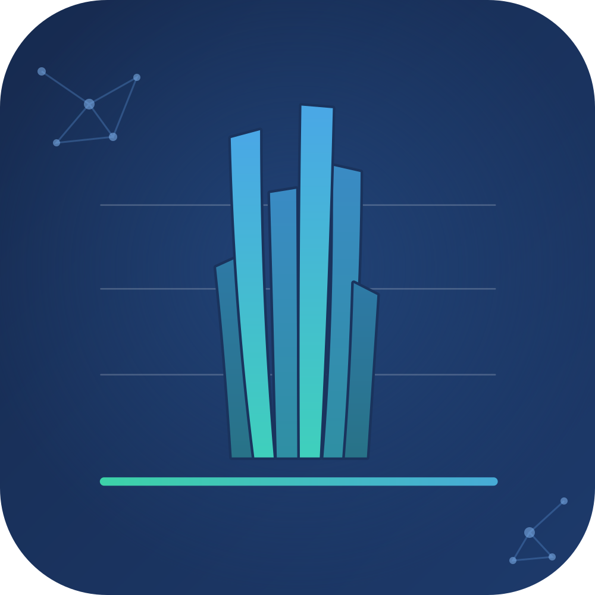

<p align="center">
  <a href="https://github.com/dse-club-kfupm"></a>
</p>

<h1 align="center">Pay Later</h1>

<p align="center">
  <b>Who will miss the next payment?</b><br>
  A term 262 learning project of the <a href="https://github.com/dse-club-kfupm">Data Engineering &amp; Science Club, KFUPM</a>
</p>

<p align="center">
  <a href="https://docs.python.org/3/tutorial/"></a>
  <a href="https://jupyter.org"></a>
  <a href="https://pandas.pydata.org"></a>
  <a href="https://scikit-learn.org"></a>
  <a href="https://matplotlib.org"></a>
  <a href="https://www.manim.community"></a>
</p>

<p align="center">
  <a href="https://github.com/dse-club-kfupm"></a>
  
  <a href="#grading"></a>
  <a href="data/README.md"></a>
  <a href="https://github.com/dse-club-kfupm/262-pay-later/actions/workflows/format-check.yml"></a>
</p>

<p align="center">
  <a href="#at-a-glance"><b>At a glance</b></a> ·
  <a href="#the-data"><b>Data</b></a> ·
  <a href="#learn-first"><b>Learn first</b></a> ·
  <a href="#get-started"><b>Get started</b></a> ·
  <a href="#how-the-work-flows"><b>Workflow</b></a> ·
  <a href="#what-you-submit"><b>Submit</b></a> ·
  <a href="#grading"><b>Grading</b></a> ·
  <a href="#rules"><b>Rules</b></a>
</p>

Buy-now-pay-later and credit card services let customers spread a purchase over several months. For the company, the risk is the customer who stops paying. Spotting that risk early lets it lower a limit, send a reminder or offer a payment plan before the debt grows.

In this project you build a model that predicts whether a credit card customer will miss next month's payment, from their credit limit and six months of bills and repayments.

> [!NOTE]
> This is a case study. You will not make lending decisions about real people. You work with one public table of 30,000 anonymised credit card customers in Taiwan, recorded from April to September 2005, and show how the data science workflow (understanding, cleaning, exploring, modelling and communicating) answers the question on that table.

## At a glance

|  |  |
| --- | --- |
| **Client** | The risk team of a consumer credit company that wants an early-warning list each month |
| **Question** | Given a customer's limit, bills and repayment history, will they miss next month's payment? |
| **You predict** | `missed_payment`: 1 if the customer misses the next payment, 0 if they pay |
| **Scored by** | Balanced accuracy on a hidden test set ([details](#grading)) |
| **Training data** | 24,000 customers × 23 columns in `data/train.csv` |
| **Level** | DATA 211, Introduction to Data Science |
| **Graded out of** | 100: 50 for the prediction, 50 for charts, slides and an animation |

## The data

`data/train.csv` holds 24,000 customers, about 80% of the dataset. The committee keeps the other 20% as the hidden test set and uses it only for grading.

| Column | Meaning | Unit |
| --- | --- | --- |
| `ID` | Customer identifier, not used as a feature | number |
| `LIMIT_BAL` | Credit limit, including supplementary cards | NT dollars |
| `EDUCATION` | 1 graduate school, 2 university, 3 high school, 4 other | code |
| `AGE` | Age of the customer | years |
| `PAY_0`, `PAY_2` … `PAY_6` | Repayment status from September (`PAY_0`) back to April (`PAY_6`): -1 paid on time, 1 one month late, 2 two months late, and so on | code |
| `BILL_AMT1` … `BILL_AMT6` | Bill amount from September (1) back to April (6) | NT dollars |
| `PAY_AMT1` … `PAY_AMT6` | Amount paid from September (1) back to April (6) | NT dollars |
| `missed_payment` | **Target:** 1 missed the next payment, 0 paid | label |

Test rows contain every column except `missed_payment`.

### Watch out for

- **Few positives.** About one customer in five (22%) missed the payment. A model that always predicts 0 is right 78% of the time and still finds no one, which is why the score is balanced accuracy.
- **Undocumented codes.** `EDUCATION` also takes 0, 5 and 6, and the `PAY_` columns also take -2 and 0. None of these are in the original documentation; deciding how to treat them is part of milestone 1.
- **No `PAY_1`.** The source calls the September status `PAY_0`, so the status columns jump from `PAY_0` to `PAY_2`.
- **Removed on purpose.** Gender and marital status were dropped: a credit model should not judge a customer on them.

**Source.** Yeh, I. (2009). Default of Credit Card Clients [Dataset]. UCI Machine Learning Repository. DOI [10.24432/C55S3H](https://doi.org/10.24432/C55S3H). Licence: CC BY 4.0.

## Learn first

Everything here is at the level of DATA 211, Introduction to Data Science. If you have passed it, skim the list and open only what you are unsure about. You do not need everything on day one: learn each row before the milestone that needs it. Most Kaggle Learn courses take a few hours and run in the browser.

| When | Skill | Why you need it | Start with | Go further |
| --- | --- | --- | --- | --- |
| Before you start | Git and GitHub | Every change reaches `main` through a reviewed pull request | [Introduction to GitHub](https://github.com/skills/introduction-to-github) · GitHub Skills | [Pro Git](https://git-scm.com/book/en/v2), chapters 1 to 3 |
| Before you start | Python | The notebooks and `predict.py` are Python | [Python](https://www.kaggle.com/learn/python) · Kaggle Learn | [The Python Tutorial](https://docs.python.org/3/tutorial/) · python.org |
| Before you start | Environments | Install the project's packages without breaking anything else | [Virtual environments and packages](https://docs.python.org/3/tutorial/venv.html) · python.org |  |
| Milestone 1 | pandas | Load, inspect and reshape the table | [Pandas](https://www.kaggle.com/learn/pandas) · Kaggle Learn | [10 minutes to pandas](https://pandas.pydata.org/docs/user_guide/10min.html) · pandas docs |
| Milestone 1 | Data cleaning | Decide what to do with missing and unusual values | [Data Cleaning](https://www.kaggle.com/learn/data-cleaning) · Kaggle Learn | [Working with missing data](https://pandas.pydata.org/docs/user_guide/missing_data.html) · pandas docs |
| Milestone 1 | The field | Know what each column means in the real world | [The dataset page](https://archive.ics.uci.edu/dataset/350/default+of+credit+card+clients) · UCI Machine Learning Repository |  |
| Milestone 2 | Charts | Show how the features relate to the target | [Data Visualization](https://www.kaggle.com/learn/data-visualization) · Kaggle Learn | [Ten Simple Rules for Better Figures](https://doi.org/10.1371/journal.pcbi.1003833) · PLOS |
| Milestone 3 | Prediction | Train a first model and compare it with the baseline | [Intro to Machine Learning](https://www.kaggle.com/learn/intro-to-machine-learning) · Kaggle Learn | [Getting started](https://scikit-learn.org/stable/getting_started.html) · scikit-learn |
| Milestone 3 | Better models | Pipelines, categorical columns, missing values and leakage | [Intermediate Machine Learning](https://www.kaggle.com/learn/intermediate-machine-learning) · Kaggle Learn | [Feature Engineering](https://www.kaggle.com/learn/feature-engineering) · Kaggle Learn |
| Milestone 3 | Your score | Balanced accuracy, and a validation split that keeps the share of missed payments | [Balanced accuracy](https://scikit-learn.org/stable/modules/model_evaluation.html#balanced-accuracy-score) · scikit-learn | [Cross-validation](https://scikit-learn.org/stable/modules/cross_validation.html) · scikit-learn |
| Milestone 4 | Animation | Tell the story in motion, up to 2 minutes | [Quickstart](https://docs.manim.community/en/stable/tutorials/quickstart.html) · Manim | [Animations using Matplotlib](https://matplotlib.org/stable/users/explain/animations/animations.html) · Matplotlib |
| Milestone 4 | Slides | Take the client from the question to the answer in 5 to 7 slides | [Ten Simple Rules for Making Good Oral Presentations](https://doi.org/10.1371/journal.pcbi.0030077) · PLOS |  |

## Get started

You need Python 3.10 or newer and Git.

```bash
git clone https://github.com/dse-club-kfupm/262-pay-later.git
cd 262-pay-later
python -m venv .venv
source .venv/bin/activate        # Windows: .venv\Scripts\activate
pip install -r requirements.txt
jupyter lab
```

Then open `notebooks/01_data_understanding.ipynb` and work through its questions.

- **No setup on your laptop?** Google Colab works: upload `data/train.csv`, and commit your notebooks back to this repository.
- **Making the animation?** Install Manim on its own with `pip install manim`, after the system packages listed in the [Manim installation guide](https://docs.manim.community/en/stable/installation.html).

## How the work flows

The work is split into four milestones. Each one has its own issues in the [Issues tab](https://github.com/dse-club-kfupm/262-pay-later/issues), and it is done when all of them are closed.

| Milestone | Done when |
| --- | --- |
| 1. Data understanding | Notebook 01 and the cleaning functions in `src/features.py` are merged |
| 2. Exploration | Notebook 02, with charts and written findings, is merged |
| 3. Prediction submission | Notebook 03 and `src/predict.py` are merged and pass the format check |
| 4. Visual communication | The slides and the animation or video are merged |

For every change:

1. Pick an open issue and assign yourself to it.
2. Create a branch for it: `git switch -c short-description`.
3. Commit in small steps with clear messages, then push the branch.
4. Open a pull request into `main` and write `Closes #<issue number>` in its description.
5. A teammate reviews it. When it is approved and the format check has passed, merge it.

**Validation tip for milestone 3.** Hold out a random 20% of the rows, keeping the same share of missed payments in both parts (`train_test_split` with `stratify`).

## What you submit

**Part A · Prediction (50 points)**

- [ ] `src/predict.py` with a function `predict(df)`. It receives a table with the test columns and returns 1 (will miss the payment) or 0 (will pay) per row, in the same order as the rows of `df`.
- [ ] Notebooks 01 to 03, run from top to bottom, showing how you reached the model.
- [ ] A passing format check. Run `python tests/check_submission.py` from the repository root before your final pull request; the same check also runs automatically on every pull request.

**Part B · Visual communication (50 points)**

- [ ] Clear, labelled charts in the notebooks.
- [ ] 5 to 7 slides that take the client from the question to the answer, saved as PDF in `visuals/slides/`.
- [ ] An animation or a short video of up to 2 minutes made with Python (Manim or matplotlib), with its source code and the rendered file in `visuals/animation/`. A good subject: how a customer's bills and repayments move over the six months, and how the model's estimate of risk changes as each month is added.

## Grading

Your `predict.py` is run once on the hidden test set after the submission deadline. You get the points of the highest level you reach; they are not added up.

| Level | You need | Points |
| --- | --- | --- |
| Runs | Returns a valid prediction for every test row | 10 |
| Bronze | Balanced accuracy above the baseline's 50.0% (the baseline always predicts that the customer pays) | 30 |
| Silver | Balanced accuracy of at least 60.5% | 40 |
| Gold | Balanced accuracy of at least 70.9%, the committee's reference model | 50 |

Balanced accuracy is the average of two percentages: the share of customers who missed a payment that your model catches, and the share of customers who paid that it correctly leaves alone. A model that always gives the same answer scores 50%.

| Part B | Missing | Basic | Good | Excellent |
| --- | --- | --- | --- | --- |
| Charts in the notebooks | 0 | 5 | 10 | 15 |
| Slides, 5 to 7, as PDF | 0 | 5 | 10 | 15 |
| Animation or video, made with Python, up to 2 minutes | 0 | 7 | 14 | 20 |

> [!IMPORTANT]
> Any team member may be asked to explain any part of the work. If no one can, the Part A points do not count.

## Rules

- Train only on `data/train.csv`.
- Do not add gender or marital status back from other copies of the data.
- Every change reaches `main` through a pull request reviewed by a teammate.
- `predict.py` may use only pandas, NumPy and scikit-learn, so that it runs in the grading environment. Notebooks and visuals may also use matplotlib, seaborn, plotly and Manim.
- AI tools are allowed if you declare them in the Credits section, and every member must be able to explain the work.

## Repository structure

```text
262-pay-later/
├── README.md
├── requirements.txt
├── data/
│   ├── train.csv
│   └── README.md               source and licence
├── notebooks/
│   ├── 01_data_understanding.ipynb
│   ├── 02_cleaning_and_exploration.ipynb
│   └── 03_modelling.ipynb
├── src/
│   ├── features.py             cleaning and feature functions
│   └── predict.py              submission entry point
├── models/                     saved model, if predict.py loads one
├── tests/
│   └── check_submission.py     run before submitting
└── visuals/
    ├── slides/                 presentation as PDF
    └── animation/              animation source code and rendered video
```

## Credits

- **Project leads:** Name (@github), Name (@github)
- **Contributors:** Name (@github)
- **Organized by:** Applied Projects Committee, Data Engineering & Science Club, KFUPM
- **Data:** Yeh, I. (2009). Default of Credit Card Clients [Dataset]. UCI Machine Learning Repository. DOI 10.24432/C55S3H. Licence: CC BY 4.0.
- **AI tools used:** none, or name the tool and what it was used for

---

<p align="center">
  <sub>Applied Projects Committee · <a href="https://github.com/dse-club-kfupm">Data Engineering &amp; Science Club, KFUPM</a> · نادي هندسة وعلوم البيانات</sub>
</p>
